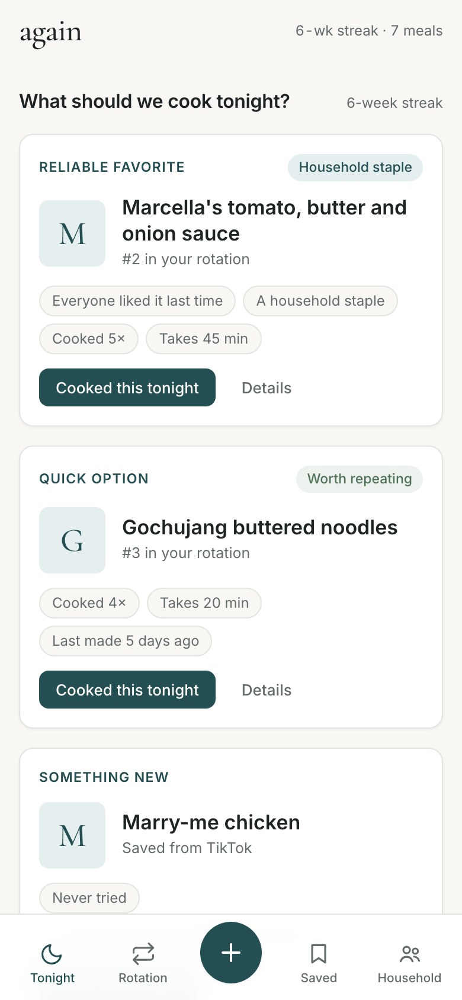
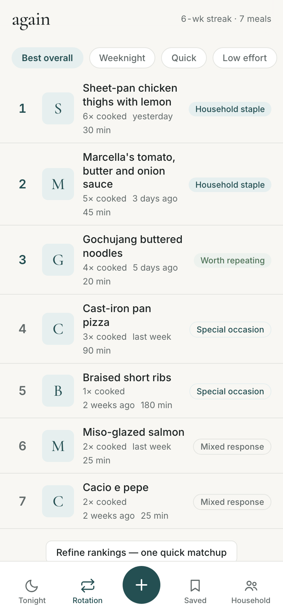
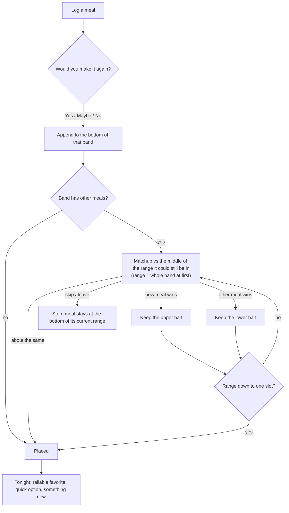
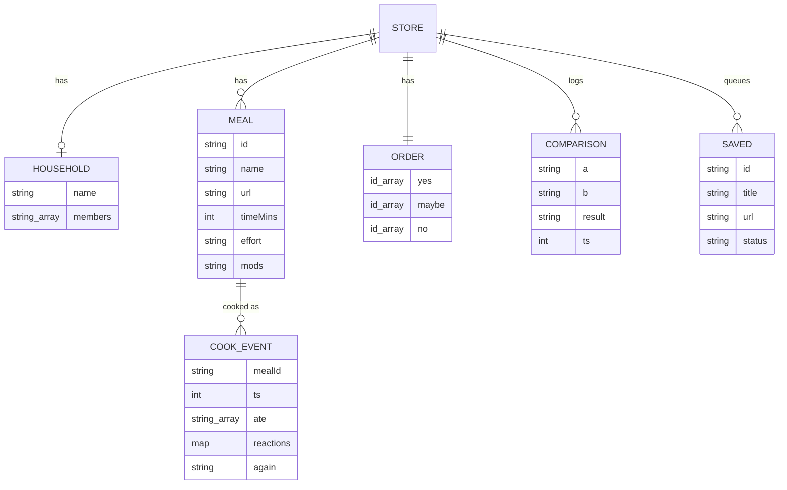

# again

A household meal tracker that ranks the dinners you actually cook by asking one question, "would you make it again?", and then suggests what to cook tonight.

[](https://github.com/jeheonlee11-create/again/actions/workflows/ci.yml)
Live: https://again-app.higgsfield.app (installable PWA, works offline after the first visit)

 

## Why

Most households cycle through the same 10 to 20 dinners, yet "what should we make tonight?" still gets argued over every evening. Recipe apps track what you might cook. This tracks what you did cook, who ate it and whether they would eat it again, and turns that into a ranked list and a short, explained suggestion.

## How it works

You log a meal (new or repeat), answer Yes / Maybe / No to "would you make it again?", and the meal goes into that band of your ranking. For a new meal, the app then asks a few "which would you rather make again?" matchups to find its exact place in the band. Onboarding builds your first ranking the same way.



The whole ranking is three ordered lists of meal ids. Everything else is derived from the cook history when needed.



Key files:

- `core.js`: all pure logic as an ES module: binary insertion (`startInsertion`, `opponent`, `answer`, `placed`), suggestion scoring (`recReliable`, `reliableScore`, `recQuick`, `recNew`, `whyFor`), store repair and migration (`normalizeStore`, `readStore`, `migrateV2`, `importStore`), and output safety (`esc`, `safeUrl`). It never touches the DOM, `localStorage` or the clock; those are passed in, which is what makes it testable in Node.
- `app.js`: the UI. It renders screens from template strings (every user value goes through `esc()`), handles events through one delegated click listener, and persists the store to `localStorage` under `again.v3`.
- `sw.js`: service worker that precaches the app shell as one versioned set for offline use.
- `index.html`: markup and all CSS. `tests/`: `node --test` suites for `core.js`.

Suggestions are rules you can read on screen, not a model. "Reliable favorite" scores yes-band meals on rank (0 to 6), times cooked (2 per cook, capped at 20), whether everyone ate it last time (6) and weeks since last made (capped at 8), and skips anything cooked in the last 3 days. "Quick option" is the best-ranked meal that takes 30 minutes or less or is marked easy. "Something new" is the latest saved recipe, else a meal cooked only once.

## Design decisions and trade-offs

- **Pairwise matchups over star ratings.** People are inconsistent at absolute scores (is this a 4 or a 5?) but quick and fairly consistent at "this one or that one". Answers are also cheap to give at the dinner table. The cost is that a ranking needs several answers instead of one, which is why the next point matters.
- **Binary insertion over comparing against every meal.** A new meal is compared with the middle of the range it could belong in, halving the range each time, so it needs at most ceil(log2(n+1)) answers instead of up to n. Stopping early is allowed and leaves the meal at the lowest position its answers support, so a skipped matchup never inflates a meal.
- **Yes / Maybe / No bands plus order within bands.** The band is the household's actual verdict and is never overridden by matchups; matchups only order meals inside a band. That keeps a single forced choice from moving a "No" above a "Yes".
- **No backend; data in `localStorage`.** No account, nothing about your meals leaves the device, and the app works offline. The price is that data lives in one browser on one device: no sync, no backup unless you use Export, and clearing site data deletes it. The code guards what it can: unreadable saves are copied to a backup key before anything can overwrite them, failed saves (storage full) are reported instead of ignored, and a second open tab adopts the first tab's writes instead of overwriting them.

## Results

There are no user numbers to report: this has not been through a user study. What can be measured is the cost of ranking.

Answers needed to place one new meal into a band of n already-ranked meals, computed in `tests/ranking.test.js` by simulating the insertion with the new meal's true position set to every possible slot (0 to n):

| Meals already in the band | Worst case | Average | Comparing one by one (worst) |
|---:|---:|---:|---:|
| 5 | 3 | 2.7 | 5 |
| 10 | 4 | 3.5 | 10 |
| 20 | 5 | 4.5 | 20 |
| 50 | 6 | 5.7 | 50 |
| 100 | 7 | 6.7 | 100 |

The same test checks that the worst case equals ceil(log2(n+1)) for every n from 0 to 128, and another test checks that repeated insertion fully sorts 30 shuffled lists. Onboarding with three meals therefore asks at most 3 matchups (1 + 2).

Reproduce with `node --test` (39 tests, no dependencies).

## Limitations and next steps

- Single device, no sync. The household "invite" link only pre-fills the household name on another device; each device keeps its own log. Sync would need a backend and accounts, which is the main thing this design avoided.
- Matchup answers are applied once and not re-checked. If tastes drift, the order only changes through "Refine rankings" (one adjacent pair at a time) or new placements. A rating model over the stored comparison history (e.g. Bradley-Terry) could rebuild the order from all answers.
- Meals and cook events cannot be renamed or deleted from the UI yet, so a mistaken log stays in the history.
- Photos are stored inline as small JPEG data URLs, so a few hundred photos can fill the roughly 5 MB `localStorage` quota. IndexedDB would remove that ceiling.
- The UI layer (`app.js`) has no automated tests; it was checked by hand in Chromium (onboarding ranking, placement matchups, offline invite link, escaping of a meal named with HTML, rejection of a `javascript:` recipe link). Only `core.js` is unit tested.
- On the hosted site, the page sends an anonymous visit ping (path, referrer host, random id) to `/api/hit`; it is skipped on plain `http` such as local runs. Meal data is never sent.

## Run it

Requires Python 3 (for a static file server) and Node 20 or newer (for tests only). There is no install or build step.

```sh
git clone https://github.com/jeheonlee11-create/again.git
cd again
python3 -m http.server 4173   # then open http://localhost:4173
node --test                   # unit tests for core.js
```

`app.js` is an ES module, so open the app through a server rather than as a `file://` page. The service worker only registers over `https`, so local runs always load fresh files. When deploying a change, bump `VERSION` in `sw.js` so installed copies pick it up.

`docs/` holds earlier planning material: the original pitch page, launch copy drafts and a manual test log.

## How it was built

Built by Jeheon Lee with AI coding assistants (Claude Code). I set the direction and design, and verified behavior with the tests and manual checks above.

## License

MIT, see [LICENSE](LICENSE).
